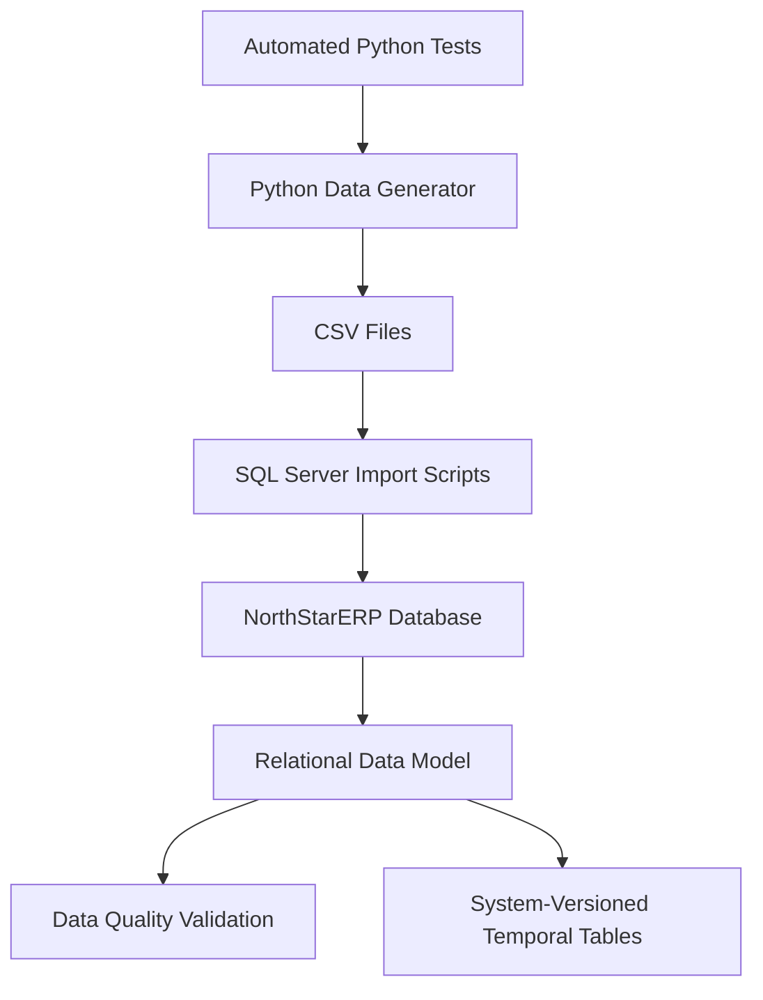

# LogiCore - ERP Data Generator & SQL Server Database

**A hands-on Data Engineering project focused on generating, loading, and validating relational ERP data.**

LogiCore simulates a simplified ERP environment. It combines a Python-based data generator with a SQL Server database, CSV-based data ingestion, relational data modeling, temporal tables, and data quality validation.

The goal is to build a realistic data workflow and practice core Data Engineering concepts, from generating consistent datasets to loading and validating data in a relational database.

## Project Overview

The current implementation covers the following workflow:

1. Generate synthetic ERP data using Python.
2. Export generated records to CSV files.
3. Load reference and business data into SQL Server using T-SQL import scripts.
4. Maintain relationships and data integrity through database constraints.
5. Track historical changes using SQL Server System-Versioned Temporal Tables.
6. Validate imported data using SQL quality checks.
7. Run automated Python tests to verify data generation logic.

## Architecture



## Technology Stack

| Technology | Purpose |
|---|---|
| Python | ERP data generation |
| SQL Server 2022 | Relational database |
| T-SQL | Data loading, constraints, and validation |
| Docker | Local SQL Server environment |
| pytest | Automated testing |
| uv | Python environment and dependency management |
| Git | Version control |

## Data Model

The database represents a simplified ERP system and separates reference data from business entities.

### Reference tables

| Table | Description |
|---|---|
| `Countries` | Country reference data |
| `Currencies` | Supported currencies |
| `UnitsOfMeasure` | Units used for products and transactions |

### Business tables

| Table | Description |
|---|---|
| `Customers` | Customer information |
| `Products` | Product catalog |
| `Orders` | Customer orders |
| `OrderDetails` | Individual order items |
| `Invoices` | Invoices associated with orders |
| `InvoiceLines` | Invoice line items |
| `Payments` | Payment transactions |

Primary keys, unique constraints, and foreign keys help maintain data integrity and enforce relationships between entities.

## Data Generation

The Python generator creates synthetic ERP data, including:

- Customers and product catalog entries.
- Orders and order details.
- Invoices and invoice lines.
- Payment transactions.
- Reference data such as countries, currencies, and units of measure.

Generated records are exported to CSV files for loading into SQL Server.

### Run the generator

The project uses `uv` to manage its Python environment and dependencies. Run these commands from the `data-generator/` directory:

```bash
uv sync
uv run python -m logicore_generator.main
```

## SQL Server Data Loading

Data is loaded into the `NorthStarERP` database through separate SQL scripts. The scripts divide the import process into logical stages:

| Script | Description |
|---|---|
| `01_import_reference_data.sql` | Imports reference data |
| `02_import_master_data.sql` | Imports customers and products |
| `03_import_orders.sql` | Imports orders and order details |
| `04_import_invoices.sql` | Imports invoices and invoice lines |
| `05_import_payments.sql` | Imports payment transactions |

The import scripts use transactions and error handling to help prevent partially completed imports. They also perform data type conversion and map business identifiers to database primary keys.

**The import scripts are designed to run once against an empty database.** They are not idempotent. Running them again against an already populated database may cause duplicate records or constraint violations.

## Temporal Tables

Seven business tables use SQL Server System-Versioned Temporal Tables:

- `Customers`
- `Products`
- `Orders`
- `OrderDetails`
- `Invoices`
- `InvoiceLines`
- `Payments`

SQL Server automatically stores previous versions of records in associated history tables. Each temporal table uses the `ValidFrom` and `ValidTo` period columns.

This provides a foundation for querying historical data and examining how records change over time.

## Data Quality Validation

The project includes a read-only SQL validation script:

```text
sql/validation/01_validate_data_quality.sql
```

The script checks:

- Row counts in business tables.
- Referential integrity between related entities.
- Missing customer, product, order, and invoice relationships.
- Invalid order quantities.
- Negative product prices.
- Invalid discount percentages.
- Temporal table configuration.

The validation queries do not modify the database.

### Latest recorded validation results

| Check | Result |
|---|---:|
| Customers | 100 |
| Products | 50 |
| Orders | 500 |
| Order details | 1,524 |
| Invoices | 182 |
| Invoice lines | 560 |
| Payments | 141 |
| Referential integrity issues | 0 |
| Invalid order quantities | 0 |
| Negative product prices | 0 |
| Invalid discounts | 0 |
| Active temporal tables | 7 of 7 |

These figures describe the latest recorded successful import and validation run. A new generator run may produce different data depending on the project configuration.

## Automated Tests

The Python data generator includes an automated test suite built with `pytest`.

Run the tests from the `data-generator/` directory:

```bash
uv run pytest src/tests/ -v
```

**Latest recorded result: 86 tests passed.**

The tests cover the data generation modules and help verify that generated ERP records follow the expected structure and business rules.

## Current Dataset

The latest recorded dataset contains **3,087 records across 10 tables**.

| Entity | Records |
|---|---:|
| Countries | 15 |
| Currencies | 5 |
| Units of Measure | 10 |
| Customers | 100 |
| Products | 50 |
| Orders | 500 |
| Order Details | 1,524 |
| Invoices | 182 |
| Invoice Lines | 560 |
| Payments | 141 |
| **Total** | **3,087** |

These figures refer to the dataset from the latest recorded successful import and validation run. They are not guaranteed to remain identical after generating a new dataset.

## Project Structure

```text
LogiCore/
├── Logicore.Database/
│   └── ...
├── data-generator/
│   ├── src/
│   │   ├── logicore_generator/
│   │   │   └── ...
│   │   └── tests/
│   │       ├── conftest.py
│   │       └── test_*.py
│   ├── sql/
│   │   ├── import/
│   │   │   ├── 01_import_reference_data.sql
│   │   │   ├── 02_import_master_data.sql
│   │   │   ├── 03_import_orders.sql
│   │   │   ├── 04_import_invoices.sql
│   │   │   └── 05_import_payments.sql
│   │   └── validation/
│   │       └── 01_validate_data_quality.sql
│   ├── pyproject.toml
│   └── uv.lock
└── README.md
```

## Project Status

- [x] Python-based ERP data generation.
- [x] CSV data export.
- [x] SQL Server database implementation.
- [x] Relational data model with primary and foreign keys.
- [x] Transactional SQL import scripts.
- [x] System-Versioned Temporal Tables.
- [x] SQL data quality validation.
- [x] Automated Python test suite (86 tests passing in the latest recorded run).
- [ ] Further development and improvements.

## Author

Developed as a hands-on Data Engineering portfolio project to practice Python, SQL Server, relational data modeling, data ingestion, automated testing, and data quality validation.
